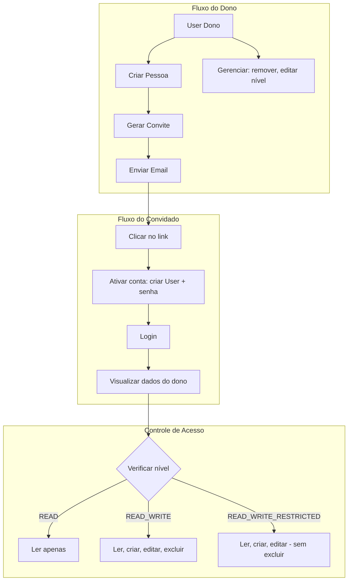

# Plano: Feature de Pessoas e Compartilhamento de Conta

## Visão Geral da Arquitetura



## 1. Alterações no Schema Prisma

Arquivo: [prisma/schema.prisma](prisma/schema.prisma)

### 1.1 Adicionar enum e campo plan na Subscription

```prisma
enum SubscriptionPlan {
  BASIC
  PREMIUM
  @@map("subscription_plan")
}

// No model Subscription, adicionar:
plan SubscriptionPlan @default(BASIC)
```

### 1.2 Novos modelos

```prisma
enum SharedAccessLevel {
  READ_ONLY
  READ_WRITE
  READ_WRITE_RESTRICTED
  @@map("shared_access_level")
}

model SharedPerson {
  id          String   @id @default(uuid()) @db.Uuid
  ownerId     String   @map("owner_id") @db.Uuid
  userId      String?  @unique @map("user_id") @db.Uuid
  name        String
  email       String
  accessLevel SharedAccessLevel @map("access_level")
  status      String   @default("PENDING")  // PENDING | ACTIVE | REMOVED
  createdAt   DateTime @default(now()) @map("created_at")
  updatedAt   DateTime @updatedAt @map("updated_at")

  owner User @relation(fields: [ownerId], references: [id], onDelete: Cascade)
  user  User? @relation(fields: [userId], references: [id], onDelete: SetNull)
  invites SharedInvite[]
  accessLogs SharedAccessLog[]

  @@unique([ownerId, email])
  @@index([ownerId])
  @@index([userId])
  @@map("shared_persons")
}

model SharedInvite {
  id             String   @id @default(uuid()) @db.Uuid
  sharedPersonId String   @map("shared_person_id") @db.Uuid
  token          String   @unique
  expiresAt      DateTime @map("expires_at")
  createdAt      DateTime @default(now()) @map("created_at")

  sharedPerson SharedPerson @relation(fields: [sharedPersonId], references: [id], onDelete: Cascade)

  @@index([token])
  @@index([expiresAt])
  @@map("shared_invites")
}

model SharedAccessLog {
  id             String   @id @default(uuid()) @db.Uuid
  sharedPersonId String   @map("shared_person_id") @db.Uuid
  ownerId        String   @map("owner_id") @db.Uuid
  accessLevel    SharedAccessLevel @map("access_level")
  action         String   // CREATED | UPDATED | REMOVED | ACTIVATED
  description    String   @db.Text  // Descrição legível da ação realizada
  createdAt      DateTime @default(now()) @map("created_at")

  sharedPerson SharedPerson @relation(fields: [sharedPersonId], references: [id], onDelete: Cascade)

  @@index([ownerId])
  @@index([sharedPersonId])
  @@map("shared_access_logs")
}
```

### 1.3 Relações no User

```prisma
// No model User, adicionar:
sharedPeopleAsOwner SharedPerson[] @relation("SharedPersonOwner")
sharedPersonAccess  SharedPerson?  @relation("SharedPersonUser")
```

## 2. Módulo People (Pessoas)

Criar novo módulo `src/modules/people/` com:

### 2.1 Estrutura de arquivos

- `people.module.ts`
- `people.controller.ts` - rotas protegidas para o dono
- `people.service.ts` - lógica de negócio
- `dto/create-person.dto.ts` - nome, email, accessLevel
- `dto/update-person.dto.ts` - accessLevel (parcial)
- `dto/person-response.dto.ts`
- `dto/activate-account.dto.ts` - token, newPassword (para endpoint público)
- Repositories: `shared-persons.repository.ts`, `shared-invites.repository.ts`, `shared-access-logs.repository.ts`

**SharedAccessLog.description**: ao registrar cada log, preencher com descrição legível (ex: "Nível alterado de Leitura para Leitura e Escrita", "Pessoa removida da conta").

### 2.2 Endpoints do dono (requer assinatura BASIC ou PREMIUM ativa)

| Método | Rota                     | Descrição                                    |
| ------ | ------------------------ | -------------------------------------------- |
| POST   | `/people`                | Criar pessoa e enviar convite (máx 4 ativas) |
| GET    | `/people`                | Listar pessoas com acesso                    |
| PATCH  | `/people/:id`            | Atualizar nível de acesso                    |
| DELETE | `/people/:id`            | Remover pessoa                               |
| GET    | `/people/access-history` | Histórico de acessos                         |

### 2.3 Endpoints públicos

| Método | Rota                      | Descrição                                                        |
| ------ | ------------------------- | ---------------------------------------------------------------- |
| GET    | `/people/activate/:token` | Validar token e retornar dados do convite (nome, email)          |
| POST   | `/people/activate`        | Ativar conta com token + senha (cria User, vincula SharedPerson) |

## 3. Resolução de Conta Efetiva (Effective Account)

Criar serviço e decorator para que tanto donos quanto convidados usem a mesma lógica de "qual conta estou acessando":

### 3.1 `EffectiveAccountService`

- `getEffectiveOwnerId(userId: string): Promise<string>` - retorna o ownerId:
  - Se o user é dono (tem dados próprios): retorna userId
  - Se o user é convidado (SharedPerson com userId): retorna ownerId
  - Erro se convidado sem SharedPerson ativo

### 3.2 `@EffectiveAccountId()` decorator

- Substitui ou complementa `@ActiveUserId()` nos controllers que precisam acessar dados da conta
- Injeta o ownerId efetivo (dono ou conta compartilhada)

### 3.3 Integração nos módulos existentes

Os serviços de Transactions, BankAccounts, Categories, Goals e Reports precisarão receber `effectiveOwnerId` em vez de `userId` para queries de dados. O `userId` do JWT continua sendo usado para:

- Identificar quem está fazendo a ação (auditoria)
- Verificar permissões (nível de acesso do convidado)

## 4. Verificação de Nível de Acesso

### 4.1 `AccessLevelGuard` ou middleware

Antes de operações sensíveis, verificar:

- **READ_ONLY**: apenas GET permitidos
- **READ_WRITE**: GET, POST, PUT, PATCH, DELETE
- **READ_WRITE_RESTRICTED**: GET, POST, PUT, PATCH - bloquear DELETE

### 4.2 Integração nos controllers

- Transactions: `remove`, `removeRecurring` - checar se não é READ_ONLY nem READ_WRITE_RESTRICTED
- BankAccounts: `remove` - idem
- Categories: `delete` - idem
- Goals: `remove` - idem

Alternativa: criar `ValidateSharedAccessService.canDelete(userId, ownerId)` usado nos services.

## 5. Fluxo de Convite e Ativação

### 5.1 Criar pessoa (POST /people)

1. Verificar assinatura ativa do dono com plan BASIC ou PREMIUM
2. Verificar limite de 4 pessoas ativas/pendentes
3. Verificar se email já foi convidado para esta conta
4. Criar SharedPerson (status PENDING)
5. Gerar token (randomBytes 32 hex), criar SharedInvite com expiresAt (ex: 7 dias)
6. Registrar SharedAccessLog (action: CREATED, description: ex. "João Silva convidado para acessar a conta")
7. Enviar email com link: `{appUrl}/activate-account?token={token}`
8. Template: `account-activation.html` (similar ao password-reset)

### 5.2 Ativar conta (POST /people/activate)

1. Buscar SharedInvite por token, verificar expiresAt
2. Se usuário já existe (email): vincular SharedPerson.userId e atualizar status ACTIVE
3. Se não existe: criar User (hash senha), vincular SharedPerson, criar Subscription trial ou não? - **Decisão**: convidado NÃO precisa de subscription; o acesso é via SharedPerson
4. Invalidar convite (deletar ou marcar como usado)
5. Registrar SharedAccessLog (action: ACTIVATED, description: ex. "Conta ativada com sucesso")

### 5.3 Login de convidado

No [auth.service.ts](src/modules/auth/auth.service.ts) `signin`:

- Se user não tem subscription ativa, verificar se tem SharedPerson ativo com owner que tem subscription ativa
- Se sim: permitir login
- Se não: manter erro atual

## 6. Bloqueio quando assinatura inativa

No `EffectiveAccountService` ou em um guard global:

- Se o effectiveOwner tem subscription inativa: apenas o próprio dono (userId === ownerId) pode acessar
- Convidados recebem 403 com mensagem: "A assinatura desta conta está inativa. Apenas o dono pode acessar para reativar."

## 7. Verificação de Plano (Basic/Premium)

A diferenciação BASIC/PREMIUM no Stripe é feita por **dois prices do mesmo produto**.

### 7.1 Configuração

- **constant-keys.ts**: adicionar `stripePriceIdBasic` e `stripePriceIdPremium`
- **.env.example**: `STRIPE_PRICE_ID_BASIC=`, `STRIPE_PRICE_ID_PREMIUM=`
- Manter ou deprecar `STRIPE_PRICE_ID` (legado) conforme migração

### 7.2 StripeService

- `createCheckoutSession(userId, successUrl, cancelUrl, email, plan: 'BASIC' | 'PREMIUM')` — usar o price ID correspondente ao plan
- Mapeamento: `plan === 'BASIC'` → `STRIPE_PRICE_ID_BASIC`, `plan === 'PREMIUM'` → `STRIPE_PRICE_ID_PREMIUM`

### 7.3 Webhook (handleCheckoutSessionCompleted e handleSubscriptionUpdated)

- Obter `price.id` de `subscription.items.data[0].price`
- Mapear para plan:
  - `price.id === STRIPE_PRICE_ID_BASIC` → `plan: BASIC`
  - `price.id === STRIPE_PRICE_ID_PREMIUM` → `plan: PREMIUM`
  - Caso contrário: fallback para `BASIC` ou log de warning
- Incluir `plan` em todos os `create` e `update` de Subscription

### 7.4 SubscriptionsController

- Endpoint de checkout: aceitar query/body `plan` (opcional, default BASIC) e repassar ao StripeService

### 7.5 PeopleService

- Antes de criar pessoa: `subscription.isActive && (subscription.plan === 'BASIC' || subscription.plan === 'PREMIUM')`
- A feature de pessoas fica disponível em ambos os planos (ajustar se apenas PREMIUM tiver no futuro)

## 8. Arquivos a Criar/Modificar

### Novos

- `prisma/migrations/xxx_add_people_feature/`
- `src/modules/people/`
- `src/shared/database/repositories/shared-*.repository.ts`
- `src/shared/services/effective-account.service.ts`
- `src/shared/decorators/effective-account-id.ts`
- `src/shared/templates/account-activation.html`

### Modificados

- [prisma/schema.prisma](prisma/schema.prisma)
- [src/app.module.ts](src/app.module.ts) - import PeopleModule
- [src/modules/auth/auth.service.ts](src/modules/auth/auth.service.ts) - permitir login de convidados
- [src/modules/webhooks/webhooks.service.ts](src/modules/webhooks/webhooks.service.ts) - mapear price.id → plan (BASIC/PREMIUM)
- [src/modules/subscriptions/services/stripe.service.ts](src/modules/subscriptions/services/stripe.service.ts) - aceitar plan e usar price ID correto
- [src/modules/subscriptions/subscriptions.controller.ts](src/modules/subscriptions/subscriptions.controller.ts) - aceitar parâmetro plan no checkout
- [src/shared/config/constant-keys.ts](src/shared/config/constant-keys.ts) - adicionar stripePriceIdBasic, stripePriceIdPremium
- `.env.example` - STRIPE_PRICE_ID_BASIC, STRIPE_PRICE_ID_PREMIUM
- Services de Transactions, BankAccounts, Categories, Goals - usar EffectiveAccountService e validar nível para DELETE
- [src/modules/notifications/notifications.service.ts](src/modules/notifications/notifications.service.ts) - suportar template account-activation

## 9. Ordem de Implementação Sugerida

1. Schema Prisma + migration
2. Repositories
3. EffectiveAccountService + decorator
4. PeopleModule (CRUD, convite, ativação)
5. Template de email
6. Ajuste AuthService (login convidado)
7. Integração EffectiveAccount nos módulos existentes
8. Guard de nível de acesso (bloquear DELETE quando READ_ONLY ou READ_WRITE_RESTRICTED)
9. Bloqueio de convidados quando assinatura inativa
10. Campo plan na Subscription + config (STRIPE_PRICE_ID_BASIC, STRIPE_PRICE_ID_PREMIUM) + StripeService + webhook
