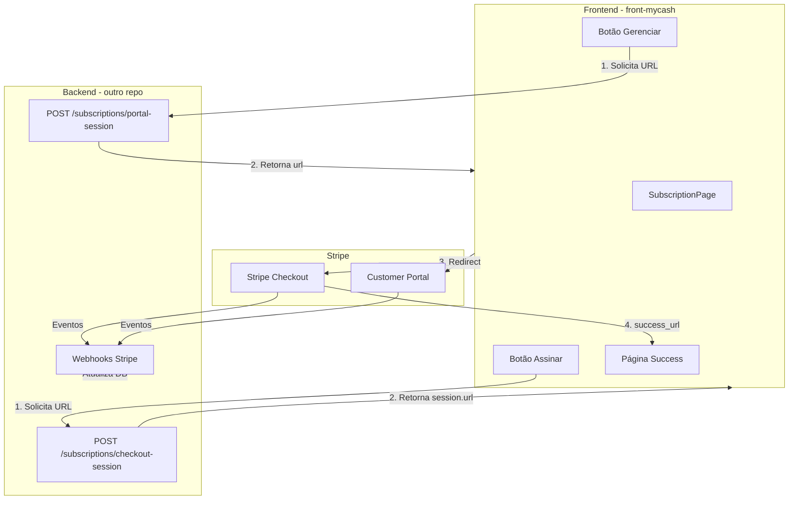

# Integração Stripe para Pagamento e Assinaturas

## Arquitetura



---

## Parte 1: Backend (repo separado)

O backend precisa expor dois novos endpoints e configurar webhooks.

### 1.1 Endpoint: Criar Checkout Session

**Rota:** `POST /subscriptions/checkout-session`

**Request:** `{ "successUrl": string, "cancelUrl": string }` (opcional; pode usar query params ou body)

**Response:** `{ "url": string }` — URL da sessão Stripe Checkout

**Lógica:**

- Obter `userId` do token JWT
- Buscar ou criar `stripeCustomerId` do usuário
- Criar [Checkout Session](https://docs.stripe.com/api/checkout/sessions/create) com `mode: "subscription"`, `line_items` com o Price ID do plano
- Usar `client_reference_id: userId` para vincular
- Retornar `session.url`

**Variáveis de ambiente:** `STRIPE_SECRET_KEY`, `STRIPE_PRICE_ID` (ou `STRIPE_WEBHOOK_SECRET`)

### 1.2 Endpoint: Criar Customer Portal Session

**Rota:** `POST /subscriptions/portal-session`

**Request:** `{ "returnUrl": string }`

**Response:** `{ "url": string }`

**Lógica:**

- Obter `userId` do token
- Buscar `stripeCustomerId` da assinatura/usuário
- Criar [Billing Portal Session](https://docs.stripe.com/api/customer_portal/sessions/create)
- Retornar `session.url`

### 1.3 Webhooks Stripe

Configurar endpoint `POST /webhooks/stripe` (ou similar) para:

- `checkout.session.completed` — criar/ativar assinatura no seu DB
- `customer.subscription.updated` — atualizar status, `nextRenewalAt`, `cancelRequestedAt`
- `customer.subscription.deleted` — marcar assinatura como cancelada

**Importante:** Validar assinatura com `stripe.webhooks.constructEvent` usando `STRIPE_WEBHOOK_SECRET`.

### 1.4 Modelo de dados

Garantir que o backend armazene `stripeCustomerId` e `stripeSubscriptionId` (ou equivalentes) para vincular usuário ↔ Stripe.

---

## Parte 2: Frontend (este projeto)

### 2.1 Novo serviço de checkout/portal

Criar em `[src/app/services/subscriptionsService/](src/app/services/subscriptionsService/)`:

- `**createCheckoutSession.ts` — `POST /subscriptions/checkout-session` com `successUrl` e `cancelUrl` (URLs absolutas da app)
- `**createPortalSession.ts` — `POST /subscriptions/portal-session` com `returnUrl`

Exportar no `[index.ts](src/app/services/subscriptionsService/index.ts)`.

### 2.2 Atualizar SubscriptionPage

Em `[src/views/pages/Subscription/index.tsx](src/views/pages/Subscription/index.tsx)`:

- **"Assinar agora" / "Renovar"**: em vez de `renewMutation.mutate()`, chamar `createCheckoutSession` e fazer `window.location.href = url`
- **"Gerenciar assinatura"** (novo botão ou substituir cancelar): chamar `createPortalSession` e redirecionar para o Customer Portal

Manter o fluxo de cancelar via API (`PATCH /subscriptions/cancel`) **ou** delegar ao Customer Portal (recomendado: usar Portal para cancelar/reativar).

### 2.3 Páginas de retorno (Success / Cancel)

- **Success:** rota `/profile/subscription?success=true` — invalidar query `['subscription']`, mostrar toast de sucesso
- **Cancel:** rota `/profile/subscription?canceled=true` — invalidar query, toast informativo

Ajustar `successUrl` e `cancelUrl` para apontar para essas rotas.

### 2.4 Variáveis de ambiente

Adicionar ao `[.env.example](.env.example)` (se necessário para URLs):

```
VITE_APP_URL=https://seu-dominio.com
```

Usar `window.location.origin` ou `import.meta.env.VITE_APP_URL` para montar `successUrl` e `cancelUrl`.

---

## Fluxo resumido

| Ação do usuário    | Frontend                | Backend               | Stripe             |
| ------------------ | ----------------------- | --------------------- | ------------------ |
| Clicar "Assinar"   | POST checkout-session   | Cria Checkout Session | —                  |
| Redirect           | `window.location = url` | —                     | Checkout hospedado |
| Pagamento OK       | Redirect success_url    | Webhook atualiza DB   | —                  |
| Clicar "Gerenciar" | POST portal-session     | Cria Portal Session   | —                  |
| Redirect           | `window.location = url` | —                     | Customer Portal    |
| Cancelar no Portal | —                       | Webhook atualiza DB   | —                  |

---

## Checklist de implementação

**Backend:**

- Instalar `stripe` e configurar `STRIPE_SECRET_KEY`, `STRIPE_PRICE_ID`, `STRIPE_WEBHOOK_SECRET`
- Endpoint `POST /subscriptions/checkout-session`
- Endpoint `POST /subscriptions/portal-session`
- Webhook para `checkout.session.completed`, `customer.subscription.updated`, `customer.subscription.deleted`
- Persistir `stripeCustomerId` e `stripeSubscriptionId` no modelo de assinatura

**Frontend:**

- `createCheckoutSession` e `createPortalSession` no `subscriptionsService`
- Alterar botões "Assinar" e "Renovar" para redirect ao Checkout
- Adicionar botão "Gerenciar no Stripe" (ou similar) que redireciona ao Portal
- Tratar `?success=true` e `?canceled=true` na SubscriptionPage
- (Opcional) Remover ou adaptar fluxo de cancelar via API se usar apenas Portal

---

## Referências

- [Stripe Checkout - Subscriptions](https://docs.stripe.com/payments/checkout/build-subscriptions)
- [Stripe Customer Portal](https://docs.stripe.com/customer-management/portal-deep-dive)
- [Stripe Webhooks](https://docs.stripe.com/webhooks)
